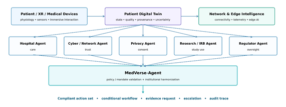
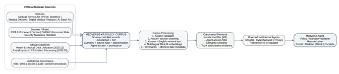

# MedVerse-Agent

**Policy-Grounded Multi-Agent Institutional Coordination for Trustworthy Digital-Twin-Enabled Medical Metaverse Systems**

**Team MedVerse · Chonnam National University · Republic of Korea**  
**ITU AI for Good Sandbox Hackathon — United Arab Emirates**

> This repository uses scenario-based modeled patient/workflow data for evaluation. No real patient records are included. Korean policy evidence is derived from publicly available laws, regulations, and official guidance.

## Submission shortcuts

- 📄 **Final report + annex:** [`submission/Team_MedVerse_Final_Report_RC4.pdf`](submission/Team_MedVerse_Final_Report_RC4.pdf)
- 🧾 **GitHub technical report:** [`submission/TECHNICAL-REPORT.md`](submission/TECHNICAL-REPORT.md)
- 🎥 **6:45 demo video:** [`submission/demo/Team_MedVerse_Demo.mp4`](submission/demo/Team_MedVerse_Demo.mp4)
- 💬 **Demo captions:** [`submission/demo/Team_MedVerse_Demo_Captions.srt`](submission/demo/Team_MedVerse_Demo_Captions.srt)
- 📚 **Korean policy corpus documentation:** [`docs/knowledge_base/`](docs/knowledge_base/)
- 🌐 **ITU / standards mapping:** [`docs/standards/`](docs/standards/)
- 📊 **Selected results:** [`docs/evaluation/`](docs/evaluation/)
- ▶️ **Quick demo:** see [Quick start](#quick-start)

---

## Why MedVerse-Agent?

A medical-metaverse workflow may involve a patient, a Digital Twin, wearable/medical sensors, a network operator, a hospital, a research institution, privacy governance, and regulatory oversight. These institutions do not receive the same information and do not have the same authority.

A Hospital Agent may need to continue clinical review while the Cyber/Network Agent marks telemetry **UNVERIFIED**. A research request may arrive while Privacy and Research/IRB independently determine whether that processing is permitted. A Regulator role may identify an oversight condition without becoming a real government authority.

MedVerse-Agent asks:

> **How can independently governed institutional agents coordinate a safe workflow without forcing consensus or transferring one institution's authority to another?**

The governing design principle is:

> **Learning proposes; policy architecture disposes.**

---

## Architecture

### Medical-metaverse / Digital-Twin system



### Korean policy evidence path



Policy jurisdiction and institutional access are constrained **before** semantic similarity. Retrieval identifies evidence; it does not itself authorize execution.

---

## Patient Digital Twin

The project-local `PatientDigitalTwin` maintains the current **evidence-bearing representation of the modeled patient episode**. Supplied observations carry provenance and contribute to evidence-quality metadata:

- freshness;
- integrity;
- completeness;
- provenance;
- uncertainty.

Digital Twin validity is represented as `VALID`, `DEGRADED`, or `UNVERIFIED`.

An `UNVERIFIED` telemetry stream means that evidence should not be treated as trustworthy; it does **not** mean the patient is healthy. The current prototype is not a patient-specific physiological simulator and does not autonomously diagnose or prescribe treatment.

---

## Three evidence layers

1. **Patient/scenario observations** — modeled patient-reported symptoms, supplied sensor values, timestamps, network/security observations and provenance.
2. **Korean oncology population context** — National Cancer Center cancer-incidence statistics for population-level context only; never used to infer patient-level clinical facts.
3. **Korean policy evidence** — statutes, subordinate instruments, official guidance and institutional-governance records used for role-bounded retrieval and policy validation.

See [`data/external/README_NCC_DATA.md`](data/external/README_NCC_DATA.md) for the NCC data status and reproducible setup.

---

## Institutional agents

| Agent | Primary responsibility | Boundary |
|---|---|---|
| Hospital | Clinical review, care workflow, record responsibilities | Does not assume Privacy, Cyber, Research or Regulator authority |
| Cyber / Network | Telemetry, device/session and network integrity | Does not diagnose or determine treatment |
| Privacy | Purpose limitation, disclosure, minimum necessity, pseudonymization | Does not make clinical treatment decisions |
| Research / IRB | Research authorization, participant protection, review conditions | Does not convert research authority into clinical authority |
| Regulator | Modeled digital-medical-product / AI oversight | Does not impersonate a real government authority |

MedVerse-Agent is the harmonizer, not a sixth peer institution.

---

## Korean policy knowledge base

The current candidate corpus contains **44 curated policy records**, with **42 configured as retrieval-eligible**. Representative sources include:

- Medical Service Act;
- Personal Information Protection Act (PIPA);
- Bioethics and Safety Act;
- Medical Devices Act;
- Digital Medical Products Act;
- AI Basic Act;
- PIPA Enforcement Decree;
- Personal Information Security Measures Standard;
- Health & Medical Data Utilization Guideline;
- Pseudonymized Information Processing Guideline.

Detailed mappings are in [`docs/knowledge_base/`](docs/knowledge_base/).

### Retrieval

Two backends are supported:

- **BM25 lexical retrieval** — lightweight default for reproducible local demonstration;
- **multilingual semantic retrieval** — `sentence-transformers/paraphrase-multilingual-MiniLM-L12-v2`, 384-dimensional normalized embeddings, cosine-equivalent dot-product ranking, top-k = 3.

Measured predefined-query Recall@3:

| Retrieval | English | Korean |
|---|---:|---:|
| BM25 lexical | 85% | 85% |
| multilingual MiniLM | 95% | 75% |

These scores evaluate evidence retrieval, not legal applicability or arbitrary-language capability.

---

## Main evaluation questions

### RQ1 — Are institutional decisions grounded in reliable evidence?

Audited Privacy/Cyber components, Digital Twin provenance/freshness checks, and Korean/English policy retrieval provide bounded evidence for component correctness.

### RQ2 — Does explicit institutional coordination improve the joint workflow?

The frozen B1–B5 architectural comparison separates omniscient, unconstrained, consensus-style, policy-filter-only and MedVerse-Agent architectures. The key B4→B5 result on the frozen benchmark is:

- Coordination Quality: **0.600 → 1.000**
- Exact Workflow Match: **0.143 → 1.000**

See [`submission/TECHNICAL-REPORT.md`](submission/TECHNICAL-REPORT.md) and [`docs/evaluation/architectural_coordination_quality.png`](docs/evaluation/architectural_coordination_quality.png).

### RQ3 — What changes when information arrives progressively?

Follow-on studies isolate proposal ordering, alternative-workflow selection and bounded commitment under partial information. Bounded waiting improves some continuations but loses others; capable comparators retain ties rather than being weakened.

Selected figures:

- [Digital Twin freshness](docs/evaluation/digital_twin_freshness.png)
- [Bilingual retrieval](docs/evaluation/bilingual_retrieval.png)
- [Commitment trade-off](docs/evaluation/commitment_tradeoff.png)
- [Institutional contributions](docs/evaluation/agent_contributions.png)
- [Commitment timeline](docs/evaluation/commitment_timeline.png)

---

## ITU-T Y.3172 and AI Readiness alignment

MedVerse-Agent maps the use case to `SRC → C → PP → M → P → D → SINK`, while adding explicit institutional mandate, evidence and action-authority checks around the policy/decision path. The project also identifies healthcare-specific opportunities around Digital Twin provenance, purpose/recipient context, institutional-agent descriptors and interoperable coordination states.

See [`docs/standards/`](docs/standards/).

---

## Quick start

### Lightweight reproducible demo (BM25)

```bash
python -m venv .venv
# macOS/Linux
source .venv/bin/activate
# Windows PowerShell: .venv\Scripts\Activate.ps1

pip install -r requirements.txt
python -B run_presenter_sandbox.py --open --backend bm25
```

Open: `http://127.0.0.1:8765`

Key routes:

- `/` — commitment / coordination workspace
- `/foundation` — Digital Twin / clinical workspace
- `/presentation` — presentation and selected results

### Dense multilingual retrieval

```bash
pip install -r requirements-gate31.txt
python -B run_presenter_sandbox.py --open --backend dense
```

No automatic fallback is used when dense retrieval is explicitly requested.

---

## Recommended live demonstration

1. Open `/foundation` and explain the patient Digital Twin and evidence quality.
2. Run `P01 → PROMPT → MedVerse commitment` to show WAIT/PREPARE/COMMIT.
3. Run `P04 → NO_REPLACEMENT` to show the cost of waiting.
4. Run `P07 → APPROVAL` to show reserved oversight/human authority.
5. Change modeled authority before commitment and inspect the rejection receipt.
6. Search policy evidence in Korean and English; test an unknown exact ID.
7. Open `/presentation` and highlight the B1–B5 result, DT freshness and commitment trade-off.

---

## Reproducibility

Historical experiment directories are preserved because they contain frozen specifications, raw outputs and regression evidence. Public-facing documentation refers to studies by function rather than requiring judges to understand internal gate numbering.

Run:

```bash
python verify_final_submission.py
```

for the final packaging checks.

---

## Important boundaries

This is a modeled governance and coordination prototype. It does not establish clinical safety, legal-compliance certification, complete Korean-law coverage, arbitrary-language independence, production identity/security, or universal algorithmic superiority. Clinical interpretation and Korean-policy applicability remain appropriate subjects for qualified external review.

---

## Team MedVerse

**Chonnam National University · Republic of Korea**

- **Team leader:** Aliyu Ibrahim
- **Team members:** Jeremiah Isuwa · Abubakar Isah · Kim Jinsul
- **Contact:** ibal2010@yahoo.com
