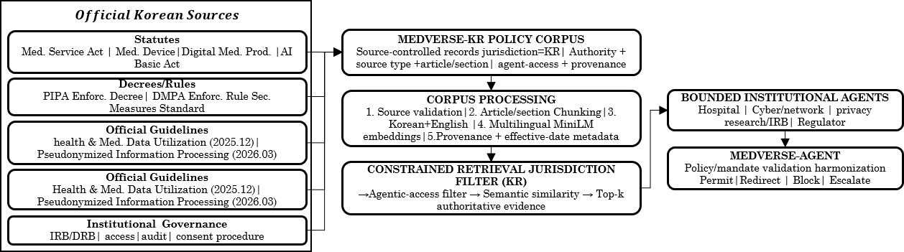

# B1. Korean Policy Corpus, Institutional Scope and Source Links

The following tables present the Korean policy knowledge base underpinning MedVerse-Agent. They identify the selected laws, regulations and official guidelines, their applicability to the five institutional agents, and the source-controlled pathway from policy evidence to institutional coordination.

## Direct repository artifacts

- **Candidate corpus registry:** [`../../data/policy/candidate_v0.4/CORPUS_REGISTRY_v0.4_candidate.json`](../../data/policy/candidate_v0.4/CORPUS_REGISTRY_v0.4_candidate.json)
- **Machine-readable policy records:** [`../../data/policy/candidate_v0.4/policy_records_v0.4_candidate.json`](../../data/policy/candidate_v0.4/policy_records_v0.4_candidate.json)
- **Knowledge-base implementation:** [`../../medverse/knowledge_base/`](../../medverse/knowledge_base/)
- **Korean policy pipeline figure:** [`../architecture/korean_policy_pipeline.png`](../architecture/korean_policy_pipeline.png)
- **Final results gallery:** [`../evaluation/RESULTS_GALLERY.md`](../evaluation/RESULTS_GALLERY.md)

> **Scope:** The corpus contains **44 indexed policy records under 13 document identifiers**, with **42 configured as retrieval-eligible**. These are curated entries, not 44 independent statutes or a complete database of Korean law. Official Korean sources remain the policy anchors; operational applicability and independent legal interpretation remain review-dependent.



## Table B1. Canonical Korean policy-corpus structure

| Corpus layer | Included sources | Primary system function | Primary agents |
|---|---|---|---|
| **Statutes** | Medical Service Act; PIPA; Bioethics and Safety Act; Medical Devices Act; Digital Medical Products Act; AI Basic Act | Define legal authority, prohibited/allowed processing, consent, clinical/research obligations and high-impact AI duties | Hospital; Privacy; Research/IRB; Regulator; Cyber where security/integrity applies |
| **Decrees / Enforcement Rules** | PIPA Enforcement Decree; Digital Medical Products Enforcement Rule; Personal Information Security Measures Standard | Translate statutory duties into safeguards, access separation, records, implementation and safety requirements | Privacy; Cyber/Network; Research/IRB; Regulator |
| **Official Guidelines** | Health & Medical Data Utilization Guideline (2025.12); Pseudonymized Information Processing Guideline (2026.03) | Operationalize pseudonymization, risk review, data sharing, AI research use, IRB/DRB, safe processing environments and documentation | Privacy; Research/IRB; Hospital; Cyber/Network; Regulator where AI governance intersects |
| **Institutional Governance** | IRB/DRB procedures; access, audit, consent and security procedures | Determine who must review, what evidence must be recorded, and when MedVerse-Agent must redirect or escalate | All agents through mandate and workflow constraints |

## Table B2. Functional mapping: what the corpus enables

| Function in MedVerse-Agent | Policy source | Agent(s) | Operational use | Official source |
|---|---|---|---|---|
| Patient-record access and disclosure boundary | Medical Service Act Art. 21 | Hospital Agent | Controls access/disclosure of medical records and supports minimum-authority routing. | [Open official source](https://www.law.go.kr/LSW/lsLinkCommonInfo.do?chrClsCd=010202&lsJoLnkSeq=1026149983) |
| EMR integrity, preservation and audit logs | Medical Service Act Art. 23 | Hospital + Cyber/Network | Grounds EMR safe management, anti-alteration/leakage and access-log preservation. | [Open official source](https://www.law.go.kr/LSW/lsLinkCommonInfo.do?chrClsCd=010202&lsJoLnkSeq=1031169077) |
| Third-party disclosure and purpose limitation | PIPA Arts. 17–18 | Privacy Agent | Determines whether disclosure/use is within authorized purpose, consent and legal basis. | [Open official source](https://www.law.go.kr/LSW/lsLawLinkInfo.do?chrClsCd=010202&lsJoLnkSeq=900078309) |
| Pseudonymized research use | PIPA Art. 28-2 | Privacy + Research/IRB | Supports bounded secondary use for statistics, scientific research and public-interest archiving, subject to applicable conditions. | [Open official source](https://www.law.go.kr/lsLinkCommonInfo.do?chrClsCd=010202&lsJoLnkSeq=1029334887) |
| Cross-controller pseudonymized-data combination | PIPA Art. 28-3 | Privacy + Research/IRB | Requires specialized combination mechanisms and controlled export of combined information. | [Open official source](https://www.law.go.kr/lsLinkCommonInfo.do?chrClsCd=010202&lsJoLnkSeq=1029334887) |
| Safeguards and processing records | PIPA Art. 28-4 + Enforcement Decree Art. 29-5 | Privacy + Cyber + Research/IRB | Grounds separation of additional information, access controls, safeguards, processing records and retention. | [Open official source](https://www.law.go.kr/LSW/lsLinkCommonInfo.do?chrClsCd=010202&lspttninfSeq=159009) |
| Re-identification prohibition / stop-and-destroy response | PIPA Art. 28-5 | Privacy + Research/IRB | Blocks deliberate re-identification and supports stop/recovery/destruction actions if identity is exposed. | [Open official source](https://www.law.go.kr/lsLinkCommonInfo.do?chrClsCd=010202&lsJoLnkSeq=1029334887) |
| IRB authority and research oversight | Bioethics and Safety Act Art. 10 | Research/IRB Agent | Defines institutional IRB authority for ethical/scientific review, consent and participant protection. | [Open official source](https://www.law.go.kr/lsLinkCommonInfo.do?chrClsCd=010202&lsJoLnkSeq=1029630879) |
| Human-subject consent | Bioethics and Safety Act Art. 16 | Research/IRB Agent | Grounds consent requirements for human-subject research. | [Open official source](https://law.go.kr/LSW/lsLinkCommonInfo.do?chrClsCd=010202&lsJoLnkSeq=1030696007) |
| Research consent withdrawal / human-derived material | Bioethics and Safety Act Art. 37 | Research/IRB Agent | Supports withdrawal-aware research restrictions and audit/evidence handling within the provision's applicable scope. | [Open official source](https://law.go.kr/LSW/lsLinkCommonInfo.do?chrClsCd=010202&lsJoLnkSeq=1029630779) |
| Medical-device clinical-trial approval and participant consent | Medical Devices Act Art. 10 | Regulator + Research/IRB | Constrains investigational medical-device trials and participant protection. | [Open official source](https://www.law.go.kr/LSW/lsLinkCommonInfo.do?chrClsCd=010202&lsJoLnkSeq=1033777249) |
| Digital medical-product scope | Digital Medical Products Act Art. 2 | Regulator Agent | Determines whether a digital product falls within the regulated digital-medical-product scope. | [Open official source](https://law.go.kr/LSW/lsLinkCommonInfo.do?lsJoLnkSeq=1031809295) |
| Digital medical-product safety evidence | DMPA Enforcement Rule Art. 14 | Regulator Agent | Supports safety, validation and cybersecurity evidence requirements within the rule's applicable trial-plan context. | [Open official source](https://www.law.go.kr/LSW/lsLinkCommonInfo.do?chrClsCd=010202&lspttninfSeq=192795) |
| High-impact AI safety, risk management and human oversight | AI Basic Act Arts. 27, 32–35 | Regulator Agent | Grounds candidate high-impact classification, safety/reliability, human oversight, documentation and impact-assessment duties. | [Open official source](https://www.law.go.kr/LSW/lsLinkCommonInfo.do?lsJoLnkSeq=1031809457) |
| Operational health-data governance | Health & Medical Data Utilization Guideline (2025.12) | Privacy + Research/IRB + Hospital + Cyber | Operationalizes health-data pseudonymization, minimum-necessary processing, IRB/DRB coordination, risk review and controlled AI-research environments. | [Open official source](https://www.khis.kr/board.es?act=view&bid=0001&list_no=2267&mid=a10301000000) |
| Risk-based pseudonymization and AI-development workflows | Pseudonymized Information Processing Guideline (2026.03) | Privacy + Research/IRB + Cyber; Regulator where AI intersects | Defines the five-stage pseudonymization workflow, risk model, safe management, non-structured data treatment, AI-development examples and required records. | [Open official source](https://www.kisa.or.kr/2060202/form?lang_type=KO&postSeq=138) |
| Technical, administrative and physical security controls | Personal Information Security Measures Standard | Cyber/Network Agent | Grounds minimum safeguards, access controls and security-management expectations for personal-information systems. | [Open official source](https://www.law.go.kr/LSW/admRulInfoP.do?admRulSeq=2100000281400) |

## Table B3. Corpus inventory by document group

| Source group / document identifier grouping | Records | Eligible | Type | Recorded date |
|---|---:|---:|---|---|
| Medical Service Act | 1 | 1 | statute | 2026-10-02 |
| Personal Information Security Measures Standard | 1 | 1 | administrative_rule | 2026-07-01 |
| Personal Information Protection Act | 6 | 6 | statute | 2026-09-11 |
| Bioethics and Safety Act | 3 | 3 | statute | 2025-10-01 |
| Digital Medical Products Act | 1 | 1 | statute | 2026-10-08 |
| Enforcement Rule of the Digital Medical Products Act | 1 | 1 | enforcement_rule | 2026-01-24 |
| Medical Service Act (second document identifier) | 1 | 1 | statute | 2026-10-02 |
| Enforcement Decree of the Personal Information Protection Act | 1 | 1 | decree | 2026-09-11 |
| Medical Devices Act | 1 | 1 | statute | 2026-10-08 |
| Framework Act on the Development of Artificial Intelligence and Establishment of Trust | 5 | 5 | statute | 2026-07-21 |
| Health and Medical Data Utilization Guideline | 10 | 10 | official_guideline | Not recorded |
| PIPC Press Release on 2026 Pseudonymized Information Guideline Revision | 2 | 0 | press_release | Not recorded |
| Pseudonymized Information Processing Guideline | 11 | 11 | official_guideline | Not recorded |

## Table B4. Role-eligible evidence scope

| Role | Eligible records | Meaning |
|---|---:|---|
| Hospital | 6 | Shared records may serve several roles; not a completeness or accuracy score. |
| Cyber/Network | 12 | Shared records may serve several roles; not a completeness or accuracy score. |
| Privacy | 28 | Shared records may serve several roles; not a completeness or accuracy score. |
| Research/IRB | 30 | Shared records may serve several roles; not a completeness or accuracy score. |
| Regulator | 8 | Shared records may serve several roles; not a completeness or accuracy score. |

## Retrieval and action boundary

```text
retrieval eligibility
  → KR jurisdiction
  → institutional agent access
  → BM25 or multilingual MiniLM ranking
  → top-k source-linked evidence
  → institutional proposal
  → mandate / purpose / authority validation
  → MedVerse-Agent harmonization
```

A retrieved passage provides evidence; it does **not** independently establish applicability or authorize an action. Source-record hashes establish integrity relative to the retained snapshot, not legal correctness. Institutional SOPs and authority records used in the scenario library are modeled unless separately documented.
